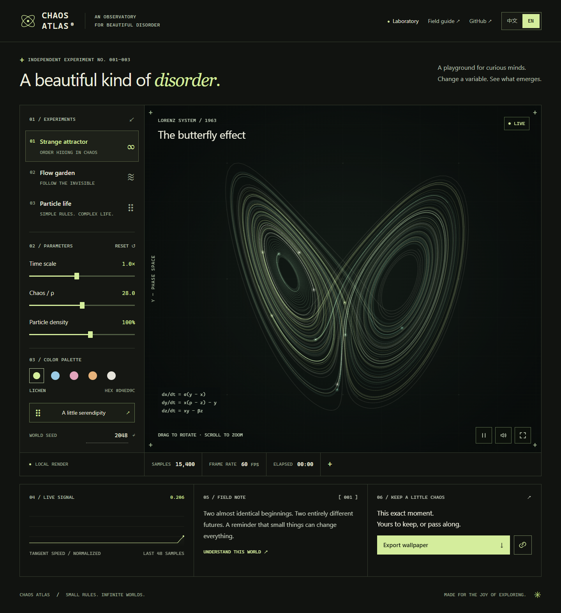
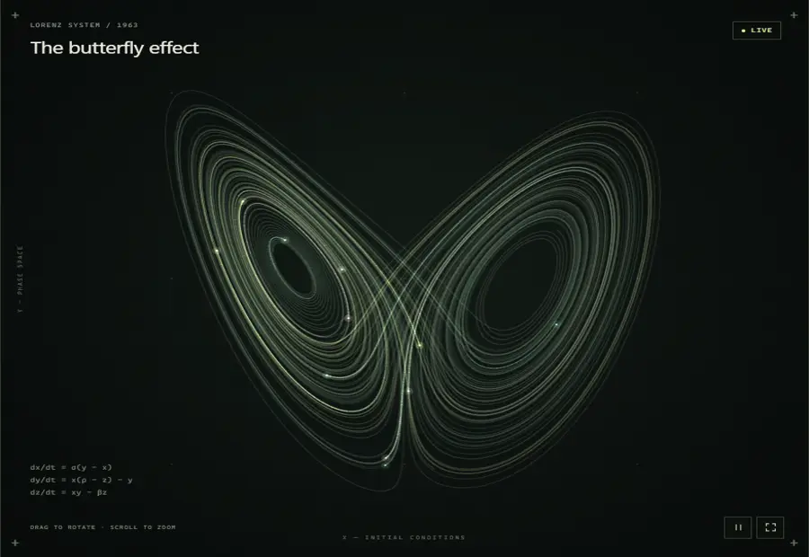

<div align="center">

# CHAOS ATLAS

**A small observatory for beautiful disorder.**

An interactive playground for chaotic systems, living particles, and generative wallpapers.

[简体中文](./README.zh-CN.md) · [Run locally](#run-locally) · [Deploy](#deploy-to-github-pages) · [MIT License](./LICENSE)





</div>

**[Open the live observatory →](https://bidepanwin.github.io/chaos-atlas/)** · [Source on GitHub](https://github.com/bidepanwin/chaos-atlas)

Live on GitHub Pages. You can also run it locally at [http://localhost:4173](http://localhost:4173) using the commands below.

## The experiments

| Experiment | What you see | What shapes it |
| --- | --- | --- |
| Lorenz attractor | Fine trails tracing the wings of a chaotic attractor | Numerical integration of the Lorenz equations |
| Flow field | Filaments moving through a changing vector field | A seeded field and cursor interaction |
| Particle life | Colored particles forming moving clusters | Pairwise attraction, repulsion, and damping |

These are visual experiments. The particle-life rules are a simplified artificial-life model; the scenes are not a calibrated physical simulation or a research instrument.

## Make it your own

- Switch between three live scenes.
- Adjust particle density, time scale, and the scene's complexity or Lorenz ρ parameter.
- Choose from five palettes—Lichen, Glacier, Rose, Ember, and Silver—or explore a new seed.
- Share a URL containing the scene configuration and seed.
- Export a PNG wallpaper, including a 4K option.
- Turn on an optional generative observatory melody. It is synthesized locally with Web Audio, responds to the active scene, and never starts until you choose it.
- Pause, restart, or enter a distraction-free view.
- Use a responsive interface with keyboard-accessible controls and reduced-motion support.
- Read comfortably with 16px body text, 14–16px controls, and labels of at least 12px. On phones, the canvas appears before the settings and text panels stack vertically.

Everything runs in the browser. There is no account, backend, analytics, CDN, or API key. The live readouts come from the running simulation.

Shared links recreate the initial configuration; they do not record an exact animation frame, elapsed time, or mouse movement. Device performance and viewport shape can affect the resulting image.

Wallpaper export redraws the current scene geometry at the selected resolution rather than enlarging a screenshot. Changing the output aspect ratio changes the framing. Immersive mode fills the browser viewport and hides the surrounding interface; it does not require the browser's native fullscreen API.

### Keyboard controls

| Key | Action |
| --- | --- |
| `1`, `2`, `3` | Switch experiments |
| `Space` | Pause or resume |
| `R` | Explore a new seed |
| `F` | Enter or leave immersive mode |
| `Esc` | Close a dialog or leave immersive mode |

Use the visible **中文 / EN** options in the header to switch languages on desktop or mobile. The current choice is highlighted and saved for future visits. Language selection follows this order: a valid `lang=zh` or `lang=en` URL parameter → saved preference → browser language → English. Switching languages keeps the current experiment and parameters intact.

Sound is intentionally opt-in. Click the speaker button inside the canvas, then adjust volume or mute it from the small sound dock. Browsers require a user gesture before Web Audio can start; browsers without Web Audio simply disable the control.

Open directly in [中文](https://bidepanwin.github.io/chaos-atlas/?lang=zh) or [English](https://bidepanwin.github.io/chaos-atlas/?lang=en).

## Run locally

Install [Node.js](https://nodejs.org/) 20 or newer, then run these commands from the **`chaos-atlas` project folder**:

```sh
npm run dev
```

Open [http://localhost:4173](http://localhost:4173). There are **zero npm dependencies** and no install step. Use the local server rather than opening `index.html` as a `file://` URL, because the app uses native JavaScript modules.

```sh
npm run check     # Check JavaScript syntax
npm run build     # Copy the deployable site to dist/
npm run preview   # Serve dist/ at http://localhost:4173
```

To use another port:

```sh
npm run dev -- --port 4180
```

To test on a phone on the same network, run `npm run dev -- --host 0.0.0.0` and open your computer's LAN address with port `4173`. Clipboard availability depends on browser permissions and secure-context support; if copying is unavailable, select and copy the link from the share dialog.

## Deploy to GitHub Pages

The **contents of `chaos-atlas/` should be the root of its own repository**. The included workflow expects that layout and deploys the generated `dist/` folder.

1. Create a new empty GitHub repository, for example `chaos-atlas`.
2. From this project folder, commit and push the files. Replace `YOUR_USERNAME` with your GitHub account:

   ```sh
   git init -b main
   git add .
   git commit -m "Create Chaos Atlas"
   git remote add origin https://github.com/YOUR_USERNAME/chaos-atlas.git
   git push -u origin main
   ```

3. In the repository, open **Settings → Pages → Build and deployment → Source** and select **GitHub Actions**.
4. Open **Actions → Deploy Chaos Atlas to GitHub Pages**. If the first run happened before Pages was enabled, rerun it or use **Run workflow**.
5. After the deployment succeeds, copy the actual URL from the `github-pages` environment into the demo section at the top of both README files.

For an ordinary project repository, the expected address follows this pattern: `https://YOUR_USERNAME.github.io/chaos-atlas/`. This is an example, not a live demo link. Relative asset paths also support a custom domain or a different repository name.

You can host `dist/` on any static host. No routing rewrite or server-side runtime is required.

## How it is built

Native HTML, CSS, and ES modules, with Canvas 2D for the simulations. The small Node scripts only serve files, check syntax, and prepare deployment output. Assets and fonts use local files or system fallbacks.

```text
chaos-atlas/
├── index.html
├── src/                   # Styles, UI, and simulation modules
├── assets/                # Icons and preview image
├── scripts/               # Dependency-free local tooling
└── .github/workflows/     # GitHub Pages deployment
```

For slower devices, reduce particle density. High-resolution export is a separate render and may take a moment. The app respects the operating system's reduced-motion preference; you can start an experiment deliberately using its playback control.

## Ideas and contributions

Useful additions include new field equations, well-tested visual presets, accessibility improvements, and browser-performance fixes. Keep the application self-contained and explain any mathematical model you introduce. Include a screenshot or short recording for visual changes, plus the browser and device used to check them.

If this little observatory gives you an idea or a wallpaper you enjoy, a star helps others find it.

## License and inspiration

[MIT](./LICENSE), © 2026 Chaos Atlas contributors.

The Lorenz scene draws on Edward N. Lorenz's *Deterministic Nonperiodic Flow* (1963), [doi:10.1175/1520-0469(1963)020<0130:DNF>2.0.CO;2](https://doi.org/10.1175/1520-0469%281963%29020%3C0130%3ADNF%3E2.0.CO%3B2). The flow-field and particle-life scenes use procedural vector fields and a simple interaction model. The interface is an original interpretation of scientific observatories and instrument panels; it does not embed third-party site code, artwork, or audio.
