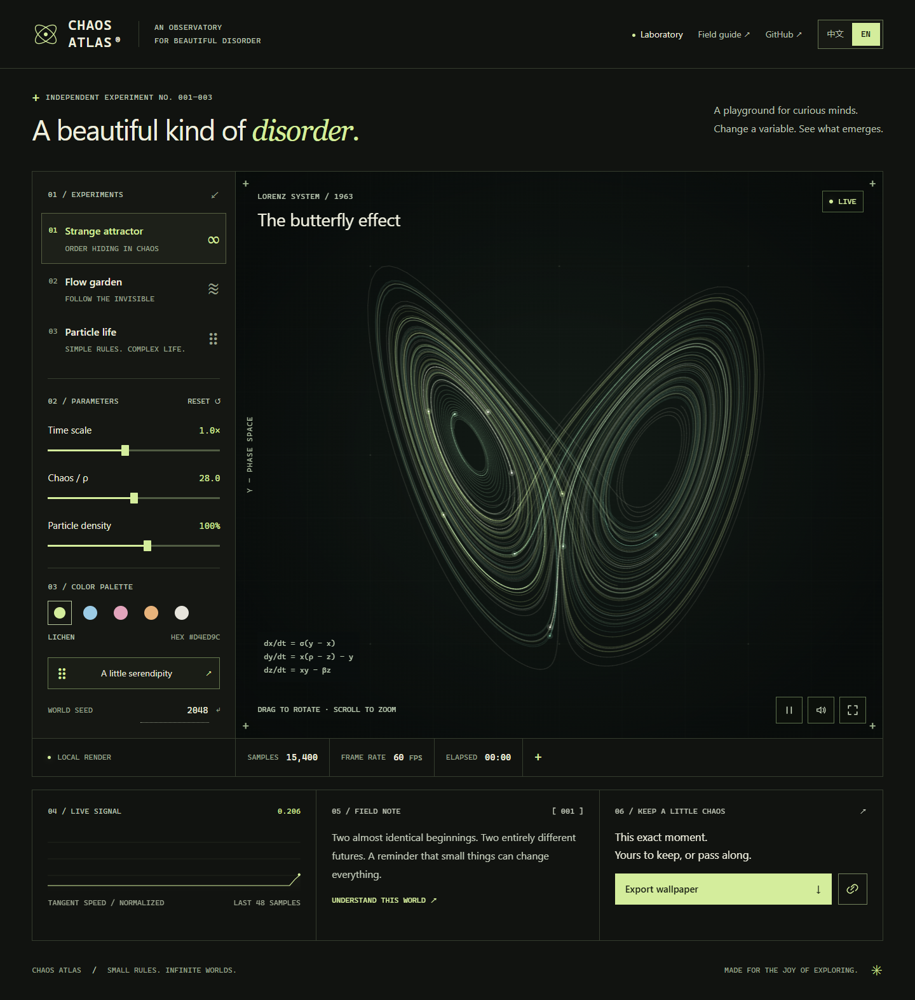
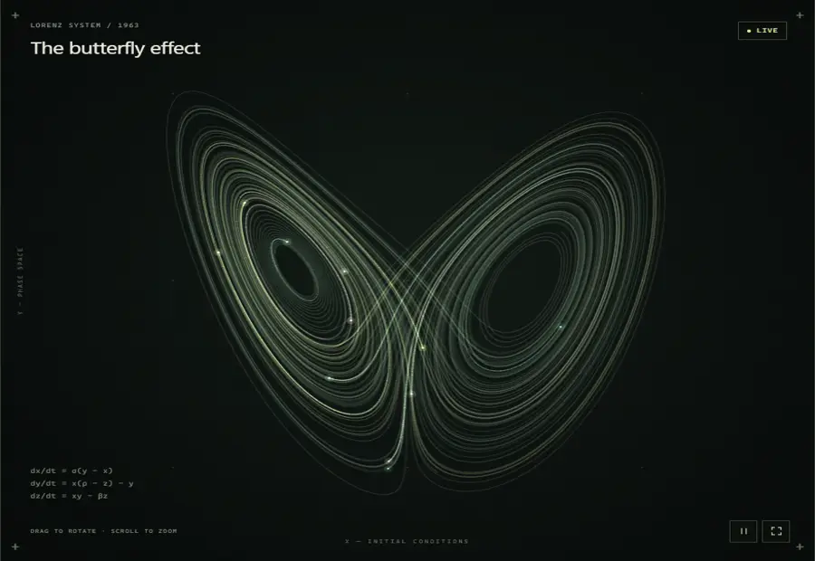

<div align="center">

# CHAOS ATLAS · 混沌图谱

**一座观察美丽失序的小型实验室。**

探索混沌轨迹、粒子生命与流场，亲手生成一张属于自己的动态画面。

[English](./README.md) · [本地运行](#本地运行) · [部署到-github-pages](#部署到-github-pages) · [MIT 开源协议](./LICENSE)





</div>

**[打开在线实验室 →](https://bidepanwin.github.io/chaos-atlas/)** · [GitHub 源码仓库](https://github.com/bidepanwin/chaos-atlas)

已部署至 GitHub Pages。也可以按下方步骤启动项目，通过 [http://localhost:4173](http://localhost:4173) 在本地体验。

## 三个实验

| 实验 | 画面 | 运动规则 |
| --- | --- | --- |
| 洛伦兹吸引子 | 细密轨迹勾勒出蝴蝶双翼 | 数值积分洛伦兹方程 |
| 流场花园 | 丝线沿着不断变化的场流动 | 带种子的向量场与鼠标交互 |
| 粒子生命 | 不同颜色的粒子聚集、分散、追逐 | 粒子间吸引、排斥与阻尼 |

这些场景用于视觉探索。粒子生命采用简化的人工生命规则；本站不是经过校准的物理仿真工具或科研测量仪器。

## 可以怎么玩

- 切换三个动态实验场景。
- 调整粒子密度、时间流速，以及场景复杂度或洛伦兹方程的 ρ 参数。
- 尝试 Lichen、Glacier、Rose、Ember、Silver 五种配色，改变随机种子，探索新的形态。
- 把场景配置与种子写入链接，分享给别人。
- 导出 PNG 壁纸，支持 4K 选项。
- 开启可选的生成式实验室旋律。声音由浏览器本地 Web Audio 合成，会跟随当前场景变化，只有主动点击后才会开始。
- 正文采用 16px、主要控件采用 14–16px，辅助标签不小于 12px；手机上优先展示画布，设置和文字面板纵向排列。
- 暂停、重新开始，或者进入沉浸视图。
- 使用适配手机的界面、键盘可操作控件和减少动态效果支持。

所有计算都在浏览器本地完成。无需账号、后端、统计服务、外部 CDN 或 API Key；运行仪表显示来自实际模拟的数据。

分享链接保存的是**初始配置**，不会保存某一动画帧、运行时长或鼠标移动过程。屏幕比例和设备性能也可能影响画面结果。

壁纸导出会按照所选分辨率重新绘制**当前场景的几何形态**，而不是放大截图。改变导出比例会改变取景。沉浸模式填满浏览器视口并隐藏周边界面，不需要浏览器原生全屏权限。

### 键盘操作

| 按键 | 操作 |
| --- | --- |
| `1`、`2`、`3` | 切换实验 |
| `Space` | 暂停或继续 |
| `R` | 探索新的随机种子 |
| `F` | 进入或退出沉浸模式 |
| `Esc` | 关闭弹窗或退出沉浸模式 |

通过页头显著的 **中文 / EN** 两个选项切换语言，桌面和手机均可使用。当前语言会高亮显示，并保存为下次访问的偏好。语言选择优先级为：有效的 `lang=zh` 或 `lang=en` URL 参数 → 已保存选择 → 浏览器语言 → 英语。切换语言会保留当前实验和参数。

声音默认关闭。点击画布工具栏中的扬声器按钮后即可开启，再通过声音面板调节音量或静音。浏览器需要用户主动操作后才能启动 Web Audio；不支持 Web Audio 的浏览器会自动禁用声音按钮。

也可以直接打开[中文版](https://bidepanwin.github.io/chaos-atlas/?lang=zh)或[英文版](https://bidepanwin.github.io/chaos-atlas/?lang=en)。

## 本地运行

安装 [Node.js](https://nodejs.org/) 20 或更新版本，在 **`chaos-atlas` 项目文件夹内**运行：

```sh
npm run dev
```

打开 [http://localhost:4173](http://localhost:4173)。项目没有 npm 依赖，**无需执行 `npm install`**。请通过本地服务器访问，直接双击 `index.html` 产生的 `file://` 地址无法可靠加载原生 JavaScript 模块。

```sh
npm run check     # 检查 JavaScript 语法
npm run build     # 将部署文件复制到 dist/
npm run preview   # 预览 dist/，默认端口 4173
```

端口被占用时可以更换：

```sh
npm run dev -- --port 4180
```

在同一局域网内用手机测试，可运行 `npm run dev -- --host 0.0.0.0`，再通过电脑局域网 IP 的 `4173` 端口访问。剪贴板功能受浏览器权限及安全上下文影响；自动复制不可用时，可以在分享弹窗中选中链接手动复制。

## 部署到 GitHub Pages

建议让 **`chaos-atlas/` 文件夹的内容成为一个独立仓库的根目录**。自带的部署工作流按此结构运行，并发布生成的 `dist/`。

1. 在 GitHub 新建一个空仓库，例如 `chaos-atlas`。
2. 在项目文件夹中提交并推送。请将 `YOUR_USERNAME` 替换为你的 GitHub 用户名：

   ```sh
   git init -b main
   git add .
   git commit -m "Create Chaos Atlas"
   git remote add origin https://github.com/YOUR_USERNAME/chaos-atlas.git
   git push -u origin main
   ```

3. 打开仓库的 **Settings → Pages → Build and deployment → Source**，选择 **GitHub Actions**。
4. 打开 **Actions → Deploy Chaos Atlas to GitHub Pages**。如果第一次运行发生在启用 Pages 之前，请重新运行，或点击 **Run workflow**。
5. 部署成功后，从 `github-pages` 环境复制真实演示地址，填入中英文 README 顶部。

普通项目仓库的地址格式通常是 `https://YOUR_USERNAME.github.io/chaos-atlas/`。这只是格式示例，并不是已经上线的演示。资源使用相对路径，也适用于自定义域名和其他仓库名称。

也可以把 `dist/` 上传到任意静态网站托管服务，无需服务端运行环境或路由重写。

## 技术结构

网站采用原生 HTML、CSS、ES 模块和 Canvas 2D。Node 脚本只负责本地服务器、语法检查和复制部署文件。资源使用本地文件，字体使用系统字体或本地回退。

```text
chaos-atlas/
├── index.html
├── src/                   # 样式、界面与模拟模块
├── assets/                # 图标与预览图
├── scripts/               # 无依赖本地工具
└── .github/workflows/     # GitHub Pages 部署
```

性能较低的设备可以降低粒子密度。高清导出会进行独立渲染，可能需要等待片刻。网站会尊重系统的“减少动态效果”偏好，你仍可以通过播放控件主动开始实验。

## 参与改进

欢迎贡献新的流场方程、经过验证的视觉预设、无障碍体验和浏览器性能改进。请保持项目自包含，并说明新增的数学模型。涉及画面变化时，请附截图或短录屏，以及验证时使用的浏览器和设备信息。

如果这里产生了一点灵感，或者一张你喜欢的壁纸，欢迎 Star，让更多人发现它。

## 开源协议与参考

[MIT](./LICENSE)，© 2026 Chaos Atlas contributors。

洛伦兹场景参考 Edward N. Lorenz 于 1963 年发表的 *Deterministic Nonperiodic Flow*，[DOI](https://doi.org/10.1175/1520-0469%281963%29020%3C0130%3ADNF%3E2.0.CO%3B2)。流场与粒子生命场景采用程序生成的向量场和简化相互作用模型。界面借鉴科学观测站与仪表盘的视觉语言，未嵌入其他网站的代码、图片或音频。
